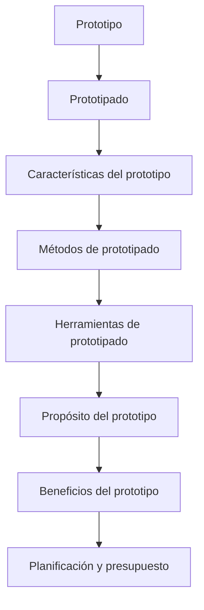

---
{"dg-publish":true,"permalink":"/interactivos/tema-1-introd-prototipado/00-tema1-indice/","dg-note-properties":{"tipo":"indice"}}
---

# 00 Tema1 - Índice

Este documento es el índice del **Tema 1: Introducción al Prototipado**. Contiene:

- **Verdades base** (nivel 0) con su frase esencial.
- **Mapa de dependencias** (mermaid) que muestra la ruta de estudio.
- **Ruta de estudio** numerada en orden topológico.
- **Índice por tema** con enlaces a los conceptos.
- Enlaces a la **Fuente** y al **Contraste**.

## Verdades base (nivel 0)

- **Prototipo**: Un modelo tangible que permite experimentar y validar ideas antes de desarrollar el producto final.
- **Prototipado**: Proceso de crear prototipos para explorar, comunicar y probar conceptos de software o hardware.

## Mapa de dependencias (mermaid)

## Ruta de estudio

1. **Prototipo**: definición y conceptos básicos.
2. **Prototipado**: métodos y herramientas.
3. **Características del prototipo**: contenido y tipos.
4. **Métodos de prototipado**: desde papel hasta software.
5. **Herramientas de prototipado**: software y físicas.
6. **Propósito del prototipo**: motivaciones y objetivos.
7. **Beneficios del prototipo**: cómo mejora el diseño y la planificación.

## Índice por tema

- [[Interactivos/Tema 1-Introd Prototipado/01 Tema1 - Contraste\|01 Tema1 - Contraste]]
- [[Interactivos/Tema 1-Introd Prototipado/Fuente - Tema1\|Fuente - Tema1]]

## Enlaces a la Fuente

- [[Interactivos/Tema 1-Introd Prototipado/Fuente - Tema1\|Fuente - Tema1]]

## Enlaces a la Contrastación

- [[Interactivos/Tema 1-Introd Prototipado/01 Tema1 - Contraste\|01 Tema1 - Contraste]]

## Notas

- Este índice se completará con la información de la fuente y el contraste.
- Se actualizará con la ruta de estudio y los enlaces a conceptos específicos.