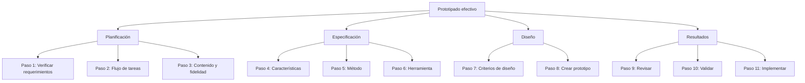

---
{"dg-publish":true,"permalink":"/interactivos/tema-2-proceso-prototipado-efect/00-tema2-indice/","dg-note-properties":{"tipo":"indice"}}
---

# 00 Tema2 - Índice

Este documento introduce el **Tema 2: El Proceso de Prototipado Efectivo**, que presenta un método estructurado de cuatro fases y once pasos para crear prototipos o gestionar el prototipado como parte del desarrollo de software.

## Verdades base (nivel 0)
- **Prototipado efectivo**: proceso repetible que combina conceptos y prototipo experimental para expresar con precisión el estado actual de comprensión del producto.
- **Prototipado escalable**: ajusta la cantidad de pasos al tiempo disponible (rápido vs exhaustivo).
- **Fases y pasos**: Planificación (pasos 1-3), Especificación (pasos 4-6), Diseño (pasos 7-8), Resultados (pasos 9-11).

## Mapa de dependencias

## Ruta de estudio
1. Prototipado efectivo y escalable
2. Planificación (pasos 1-3)
3. Especificación (pasos 4-6)
4. Diseño (pasos 7-8)
5. Resultados (pasos 9-11)

## Índice por tema
- [[Interactivos/Tema 2-Proceso Prototipado Efect/01 Tema2 - Contraste\|01 Tema2 - Contraste]]
- [[Interactivos/Tema 2-Proceso Prototipado Efect/Fuente - Tema2\|Fuente - Tema2]]

## Enlaces a la Fuente
- [[Interactivos/Tema 2-Proceso Prototipado Efect/Fuente - Tema2\|Fuente - Tema2]]

## Enlaces a la Contrastación
- [[Interactivos/Tema 2-Proceso Prototipado Efect/01 Tema2 - Contraste\|01 Tema2 - Contraste]]