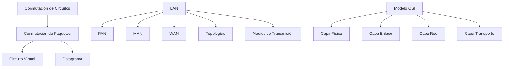

---
{"dg-publish":true,"permalink":"/redes/arc-tema-1/00-arc-tema-1-indice/","dg-note-properties":{"tipo":"indice","tema":"Introducción a Redes de Área Local","pdf":"mega/MEGA/Aprender/Redes/PDF/ARC_Tema_1.pdf"}}
---

# 00 ARC_Tema_1 - Índice

## Tema
Introducción a redes de área local: conmutación, clasificación por extensión, topologías y medios, modelo OSI.

## Verdades base (nivel 0)
- [[Redes/ARC_Tema_1/Conceptos/Conmutación de Circuitos\|Conmutación de Circuitos]]: circuito dedicado, reserva fija, 3 fases
- [[Redes/ARC_Tema_1/Conceptos/Conmutación de Paquetes\|Conmutación de Paquetes]]: datos en paquetes, multiplexación estadística
- [[Redes/ARC_Tema_1/Conceptos/Red de Área Local (LAN)\|Red de Área Local (LAN)]]: privada, alta velocidad, corta extensión, difusión típica

## Mapa de dependencias

## Ruta de estudio
1. Conmutación de Circuitos vs Paquetes → 2. Circuito Virtual / Datagrama → 3. Clasificación por extensión → 4. LAN, topologías, medios → 5. Modelo OSI (7 capas)

## Enlaces
- [[Redes/ARC_Tema_1/Fuente - ARC_Tema_1\|Fuente - ARC_Tema_1]]
- [[Redes/ARC_Tema_1/01 ARC_Tema_1 - Contraste\|01 ARC_Tema_1 - Contraste]]
- [[Redes/ARC_Tema_1/_ARC_Tema_1 - Progreso\|_ARC_Tema_1 - Progreso]]
- [[Redes/ARC_Tema_1/Conceptos/Capa Física\|Capa Física]]
- [[Redes/ARC_Tema_1/Conceptos/Capa de Enlace de Datos\|Capa de Enlace de Datos]]
- [[Redes/ARC_Tema_1/Conceptos/Capa de Red\|Capa de Red]]
- [[Redes/ARC_Tema_1/Conceptos/Capa de Transporte\|Capa de Transporte]]
- [[Redes/ARC_Tema_1/Conceptos/Capa de Presentación\|Capa de Presentación]]
- [[Redes/ARC_Tema_1/Conceptos/Capa de Sesión\|Capa de Sesión]]
- [[Redes/ARC_Tema_1/Conceptos/Capa de Aplicación\|Capa de Aplicación]]
- [[Redes/ARC_Tema_1/Conceptos/Conmutación de Circuitos\|Conmutación de Circuitos]]
- [[Redes/ARC_Tema_1/Conceptos/Conmutación de Paquetes\|Conmutación de Paquetes]]
- [[Redes/ARC_Tema_1/Conceptos/Circuito Virtual\|Circuito Virtual]]
- [[Redes/ARC_Tema_1/Conceptos/Red de Área Local (LAN)\|Red de Área Local (LAN)]]
- [[Redes/ARC_Tema_1/Conceptos/Red de Área Personal (PAN)\|Red de Área Personal (PAN)]]
- [[Redes/ARC_Tema_1/Conceptos/Red de Área Metropolitana (MAN)\|Red de Área Metropolitana (MAN)]]
- [[Redes/ARC_Tema_1/Conceptos/Red de Área Amplia (WAN)\|Red de Área Amplia (WAN)]]
- [[Redes/ARC_Tema_1/Conceptos/Topología de Red\|Topología de Red]]
- [[Redes/ARC_Tema_1/Conceptos/Medios de Transmisión\|Medios de Transmisión]]
- [[Redes/ARC_Tema_1/Conceptos/Enlace Punto a Punto\|Enlace Punto a Punto]]
- [[Redes/ARC_Tema_1/Conceptos/Enlace de Difusión\|Enlace de Difusión]]
