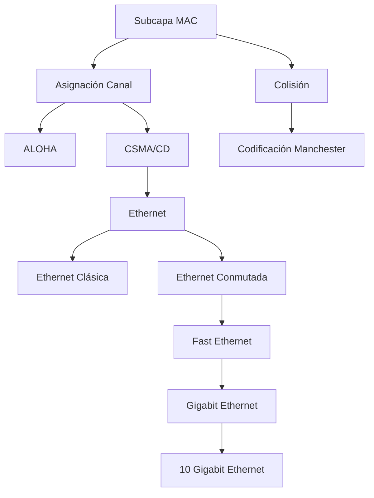

---
{"dg-publish":true,"permalink":"/redes/arc-tema-2/00-arc-tema-2-indice/","dg-note-properties":{"tipo":"indice","tema":"Arquitectura de Protocolos TCP/IP y relación con OSI","pdf":"mega/MEGA/Aprender/Redes/PDF/ARC_Tema_2.pdf"}}
---

# 00 ARC_Tema_2 - Índice

## Tema
Subcapa MAC, protocolos de acceso múltiple (ALOHA, CSMA/CD, paso de testigo), Ethernet clásica y conmutada, velocidades Fast/Gigabit/10G.

## Verdades base (nivel 0)
- [[Redes/ARC_Tema_2/Conceptos/Subcapa MAC\|Subcapa MAC]]: subcapa de enlace que gestiona acceso al canal compartido
- [[Redes/ARC_Tema_2/Conceptos/ALOHA\|ALOHA]]: acceso aleatorio básico, baja eficiencia
- [[CSMA/CD\|CSMA/CD]]: escucha antes de transmitir, detecta colisión (base Ethernet clásica)
- [[Redes/ARC_Tema_2/Conceptos/Ethernet\|Ethernet]]: estándar IEEE 802.3, evolución de velocidades (10 Mbps → 10 Gbps)

## Mapa de dependencias

## Ruta de estudio
1. MAC y asignación del canal → 2. Protocolos de acceso múltiple → 3. ALOHA / CSMA / Protocolos libres → 4. Ethernet clásica, tramas y rendimiento → 5. Ethernet conmutada → 6. Fast / Gigabit / 10G

## Enlaces
- [[Redes/ARC_Tema_2/Fuente - ARC_Tema_2\|Fuente - ARC_Tema_2]]
- [[Redes/ARC_Tema_2/01 ARC_Tema_2 - Contraste\|01 ARC_Tema_2 - Contraste]]
- [[Redes/ARC_Tema_2/_ARC_Tema_2 - Progreso\|_ARC_Tema_2 - Progreso]]
- [[Redes/ARC_Tema_2/Conceptos/ALOHA\|ALOHA]]
- [[CSMA/CD\|CSMA/CD]]
- [[Redes/ARC_Tema_2/Conceptos/Codificación Manchester\|Codificación Manchester]]
- [[Redes/ARC_Tema_2/Conceptos/Ethernet Conmutada Fast Gigabit\|Ethernet Conmutada Fast Gigabit]]
- [[Redes/ARC_Tema_2/Conceptos/Ethernet\|Ethernet]]
- [[Redes/ARC_Tema_2/Conceptos/Protocolo Subcapa MAC - Formato Trama\|Protocolo Subcapa MAC - Formato Trama]]
- [[Redes/ARC_Tema_2/Conceptos/Protocolo de Mapa de Bits\|Protocolo de Mapa de Bits]]
- [[Redes/ARC_Tema_2/Conceptos/Protocolo de Paso de Testigo\|Protocolo de Paso de Testigo]]
- [[Redes/ARC_Tema_2/Conceptos/Subcapa MAC\|Subcapa MAC]]
