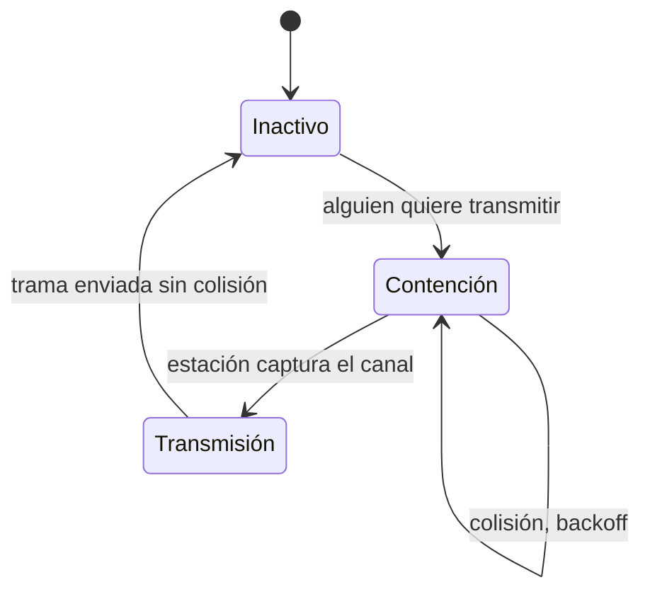

---
{"dg-publish":true,"permalink":"/redes/arc-tema-2/conceptos/csma-cd/","tags":["materia/redes","tema/protocolos"],"dg-note-properties":{"tipo":"concepto","aliases":["CSMA/CD","Carrier Sense Multiple Access with Collision Detection","CSMA con Detección de Colisión"],"tags":["materia/redes","tema/protocolos"],"nivel":1,"fuentes":["[[Redes/ARC_Tema_2/Fuente - ARC_Tema_2]]"],"contraste":"verificado","estado":"nuevo"}}
---

# CSMA/CD

> [!abstract] En una frase
> Protocolo MAC que **escucha** el canal antes de transmitir (*carrier sense*), transmite si está libre y **detecta las colisiones** leyendo lo que envía; es la base histórica de la **Ethernet clásica**.

## ¿Qué problema resuelve?
[[Redes/ARC_Tema_2/Conceptos/ALOHA\|ALOHA]] transmite "a ciegas" y provoca muchas colisiones. En una LAN cableada es fácil **oír el canal** antes de hablar: si está ocupado, me callo. Pero incluso así pueden coincidir dos estaciones que crean verlo libre a la vez, por lo que hace falta además **detectar la colisión** lo antes posible y abortar la transmisión en lugar de malgastar todo el tiempo de trama. CSMA/CD es la combinación de esas dos ideas: **escuchar antes** y **detectar durante**.

## Qué es
El material (p. 10-14) presenta la familia **CSMA (Carrier Sense Multiple Access)** y, dentro de ella, **CSMA/CD**:

- **CSMA persistente / no persistente** (p. 10-11): variantes de qué hace la estación cuando encuentra el canal ocupado.
- **CSMA/CD** (p. 12): *"los protocolos que detectan colisiones se conocen como CSMA con detección de colisiones (CSMA/CD)"*. **Base de la Ethernet clásica**.

Mecanismo (p. 12):

1. La estación transmisora **lee los datos que está transmitiendo**.
2. Si están **distorsionados**, sabe que **ha ocurrido una colisión**.
3. En ese caso, aborta y aplica un **retroceso** antes de reintentar.

### Los tres estados
Según p. 13, CSMA/CD puede estar en uno de **tres estados**:

- **Contención**: varias estaciones compiten; aquí es donde pueden ocurrir colisiones.
- **Transmisión**: una estación ya **capturó el canal** y envía su trama; según el material, **no hay más colisiones** mientras dura (p. 14).
- **Inactivo**: nadie transmite.

### El límite 2τ
En CSMA/CD una colisión puede tardar hasta **2τ** (el doble del retardo de propagación de un extremo al otro) en detectarse (p. 25). Esto importa porque:

- Si la trama es **más corta que 2τ**, la estación puede **terminar de enviar sin haberse enterado** de la colisión.
- Por eso Ethernet impone **tramas con un mínimo** y la longitud máxima del cable está relacionada con el ancho de banda y el tamaño de trama (p. 26).

Como resume el material (p. 14): *"las colisiones afectan negativamente al rendimiento del sistema (el producto retardo·ancho de banda es grande, el cable largo tiene un gran retardo de propagación y los cuadros son cortos)"*.

## Cómo podrías haberlo descubierto
Primera idea: *"antes de hablar, escucho"* (CSMA). Pero dos estaciones pueden empezar casi a la vez: si la propagación tarda, cada una ve el cable libre mientras la otra ya está emitiendo. Segunda idea: **mientras envío, me escucho a mí mismo**. Si lo que llega al cable no coincide con lo que mando, es que alguien más está encima: colisión. Esa combinación —escuchar antes y detectar durante— es exactamente CSMA/CD, y responde con naturalidad a los dos escenarios de fallo del protocolo anterior.

## Depende de
- [[Redes/ARC_Tema_2/Conceptos/Subcapa MAC\|Subcapa MAC]]: CSMA/CD es un protocolo MAC de contención.
- [[Redes/ARC_Tema_2/Conceptos/ALOHA\|ALOHA]]: el precursor conceptual sin *carrier sense*.

## Permite entender
- [[Redes/ARC_Tema_2/Conceptos/Ethernet\|Ethernet]]: su protocolo MAC clásico (p. 12).
- La **longitud máxima del cable** en Ethernet clásica y por qué Ethernet tiene un **tamaño mínimo de trama** (p. 25-26).
- Por qué, al pasar a **Ethernet conmutada** con switches (p. 29), CSMA/CD **deja de ser necesario**: cada puerto es un enlace dedicado punto a punto y no hay colisiones.

## Ejemplo
> [!example]
> Ethernet clásica a 10 Mbps sobre coaxial de 500 m (p. 21): varias estaciones comparten el cable. Cuando A quiere transmitir, escucha; si está libre, emite. Si durante la emisión detecta que el nivel del cable no coincide con lo que envía (señal distorsionada), sabe que alguien ha coincidido con ella, aborta y reintenta tras un *backoff* aleatorio (p. 12).

## Errores comunes
> [!warning]
> CSMA/CD **no evita** las colisiones; solo las **detecta temprano** para dejar de desperdiciar canal. En redes con **gran retardo de propagación** (cable muy largo) y **tramas muy cortas**, pierde eficiencia (p. 14).

> [!warning]
> Las variantes de CSMA (persistente, no persistente) **se diferencian solo en qué hacen cuando ven el canal ocupado**, no en cómo detectan la colisión.

> [!warning]
> En redes **inalámbricas** no se usa CSMA/CD sino **CSMA/CA** (collision *avoidance*), porque una estación no puede escucharse y transmitir a la vez con la antena.

## Autoevaluación
> [!question]- ¿Por qué CSMA/CD empeora cuando el cable es largo y las tramas cortas?
> Porque la colisión puede tardar hasta **2τ** en detectarse (p. 25). Si la trama se envía en menos tiempo que 2τ, la estación acaba sin enterarse de la colisión y la trama se pierde (p. 14, 25-26).

> [!question]- ¿Qué desaparece al pasar de Ethernet clásica a Ethernet conmutada?
> Las **colisiones**: cada puerto del switch es un **enlace dedicado punto a punto**, de modo que no hay canal compartido en el que pueda haber colisión (p. 29).

## Contraste
> [!success] Verificado
> La definición de CSMA/CD, los tres estados y la base en Ethernet clásica se han contrastado con Wikipedia (*Carrier-sense multiple access with collision detection*) y con el estándar histórico IEEE 802.3. Coincide con el material.

## Fuentes
- [[Redes/ARC_Tema_2/Fuente - ARC_Tema_2\|Fuente - ARC_Tema_2]], p. 10-14, 25-26

## Mis notas
