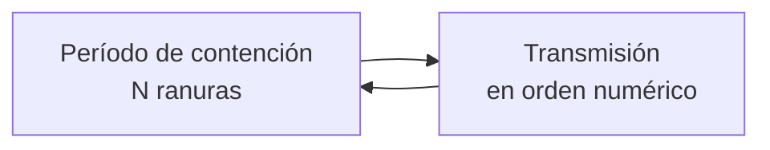

---
{"dg-publish":true,"permalink":"/redes/arc-tema-2/conceptos/protocolo-de-mapa-de-bits/","tags":["materia/redes","tema/protocolos"],"dg-note-properties":{"tipo":"concepto","aliases":["Bitmap Protocol","Mapa de Bits","Bit-Map Protocol"],"tags":["materia/redes","tema/protocolos"],"nivel":1,"fuentes":["[[Redes/ARC_Tema_2/Fuente - ARC_Tema_2]]"],"contraste":"verificado","estado":"nuevo"}}
---

# Protocolo de Mapa de Bits

> [!abstract] En una frase
> Protocolo **libre de colisiones**: antes de transmitir, cada estación **anuncia su intención** en una ranura reservada; cuando todas han anunciado, transmiten **en orden numérico sin pisarse**.

## ¿Qué problema resuelve?
Los protocolos de contención ([[Redes/ARC_Tema_2/Conceptos/ALOHA\|ALOHA]], [[Redes/ARC_Tema_2/Conceptos/CSMA_CD\|CSMA/CD]]) toleran colisiones porque las corrigen a posteriori, pero las colisiones **reducen el ancho de banda** y **aumentan el tiempo** para enviar una trama (p. 15). En aplicaciones de tiempo real (VoIP, vídeo, teleconferencia) esto se nota mucho. El mapa de bits elimina las colisiones **por diseño**, a cambio de un pequeño **coste fijo de anuncio** por ciclo.

## Qué es
Según p. 16, el protocolo funciona así, para **N estaciones** con direcciones **0 … N-1**:

1. **Período de contención**: cada ciclo comienza con exactamente **N ranuras**, una por estación.
2. Si la estación **j** tiene una trama que enviar, inserta un **bit "1"** en la **ranura j**; si no, deja la ranura en 0 (p. 16).
3. Las demás **no pueden transmitir** durante esa ranura.
4. Al terminar las N ranuras, **todas las estaciones conocen** qué estaciones quieren transmitir en este ciclo.
5. **Transmiten en orden numérico**: primero las que marcaron, en secuencia, sin colisiones.
6. Terminada la ronda de tramas, comienza un nuevo período de contención.

### Supuestos del modelo
El PDF los enumera en p. 15:
- El **retraso de propagación** se supone **insignificante** (si no, las estaciones no podrían escuchar los anuncios "en tiempo real").
- Cada estación tiene una **dirección única** entre 0 y N-1.
- Un **único canal** compartido con colisiones observables.

## Cómo podrías haberlo descubierto
Si la raíz de las colisiones es *"no sé si alguien más quiere hablar"*, la solución es *"preguntémonos todos antes de hablar"*. La forma más barata: cada uno tiene un turno de **1 bit** para decir "quiero" o "no quiero". Un bit por estación es un coste mínimo, pero garantiza que, cuando empieza la transmisión real, **nadie va a chocar**: ya hay un **orden pactado**. Es la versión más sencilla de un **protocolo de reserva**.

## Depende de
- [[Redes/ARC_Tema_2/Conceptos/Subcapa MAC\|Subcapa MAC]]: forma parte de la familia de protocolos **libres de colisiones** (p. 15).

## Permite entender
- Contraste con [[Redes/ARC_Tema_2/Conceptos/CSMA_CD\|CSMA/CD]]: aquí la contención se resuelve **antes** de transmitir, no durante.
- Idea general de **protocolos de reserva**: distinguir una fase de **anuncio** de una fase de **transmisión**.

## Ejemplo
> [!example]
> Con N=4 estaciones y, en un ciclo dado, solo B y D quieren transmitir, el período de contención sería **0 1 0 1**. Al acabar las 4 ranuras, todas saben que primero transmite B y después D; cuando D termina, comienza otro período de contención (p. 16).

## Errores comunes
> [!warning]
> El mapa de bits **no escala bien a muchas estaciones**: con N grande, el período de contención crece y el **overhead** por ciclo se dispara, aunque haya poco tráfico. Es eficiente con N moderado y tráfico alto.

> [!warning]
> No confundir el **1 bit** del anuncio con la **trama de datos**: el bit solo anuncia *"yo quiero"*; la trama real se envía después, en la fase de transmisión.

> [!warning]
> El supuesto de **retardo de propagación insignificante** (p. 15) es idealizado. En redes muy extensas no se cumple y hace falta ranuras más largas o otro protocolo.

## Autoevaluación
> [!question]- ¿Qué garantiza que no haya colisiones en el mapa de bits?
> Que durante el **período de contención** cada estación tiene una ranura reservada (nadie más puede transmitir en ella) y que, en la **fase de transmisión**, el orden es **numérico y acordado** por todas las estaciones (p. 16).

> [!question]- ¿Por qué este protocolo es ineficiente con tráfico muy escaso?
> Porque **siempre** paga el coste fijo de N ranuras de anuncio, incluso cuando casi nadie quiere transmitir. Con tráfico escaso, la mayor parte del ciclo se va en el "preguntar quién quiere hablar" (p. 15-16).

## Contraste
> [!success] Verificado
> El mecanismo descrito (período de contención con N ranuras, transmisión en orden numérico) coincide con Wikipedia (*Bit-map protocol*). No se han detectado discrepancias.

## Fuentes
- [[Redes/ARC_Tema_2/Fuente - ARC_Tema_2\|Fuente - ARC_Tema_2]], p. 15-16

## Mis notas
