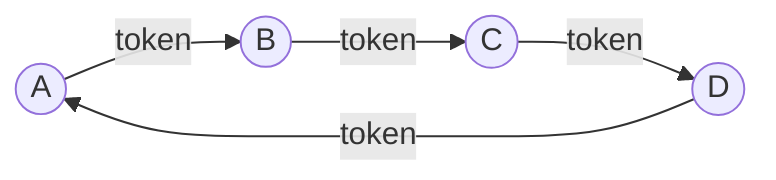

---
{"dg-publish":true,"permalink":"/redes/arc-tema-2/conceptos/protocolo-de-paso-de-testigo/","tags":["materia/redes","tema/protocolos"],"dg-note-properties":{"tipo":"concepto","aliases":["Token Ring","Token Bus","Paso de Testigo","Token Passing","Token"],"tags":["materia/redes","tema/protocolos"],"nivel":1,"fuentes":["[[Redes/ARC_Tema_2/Fuente - ARC_Tema_2]]"],"contraste":"verificado","estado":"nuevo"}}
---

# Protocolo de Paso de Testigo

> [!abstract] En una frase
> Protocolo **libre de colisiones** en el que un mensaje de control, el **testigo (*token*)**, circula entre las estaciones en un orden prefijado; **solo quien lo posee** puede transmitir.

## ¿Qué problema resuelve?
Los protocolos tipo [[Redes/ARC_Tema_2/Conceptos/ALOHA\|ALOHA]] o [[Redes/ARC_Tema_2/Conceptos/CSMA_CD\|CSMA/CD]] permiten que dos estaciones empiecen a emitir a la vez y colisionen. El material (p. 15) subraya que **las colisiones aumentan el tiempo** para enviar una trama y encajan **mal con el tráfico en tiempo real** (VoIP, vídeo, teleconferencia). El paso de testigo elimina las colisiones por diseño: **nunca hay dos estaciones autorizadas a transmitir al mismo tiempo**.

## Qué es
Según el material (p. 17): *"El mensaje (llamado testigo) se pasa a la siguiente estación en el orden predefinido. Los protocolos **Token Ring** o **Token Bus** funcionan de la misma manera"*.

Mecanismo:

1. Las estaciones se organizan en un **orden predefinido** (anillo físico o lógico).
2. Un **testigo** —una trama de control muy breve— circula por ese orden.
3. Quien lo recibe tiene dos opciones:
   - **Si tiene una trama que enviar**: la transmite y, al terminar, **entrega el testigo** a la siguiente estación.
   - **Si no tiene nada que enviar**: pasa el testigo inmediatamente.
4. El ciclo se repite indefinidamente.

### Dos variantes citadas (p. 17)
- **Token Ring**: anillo **físico** cerrado.
- **Token Bus**: estaciones conectadas en bus, con un **orden lógico** circular.

### Gestión del testigo
*"Uno tiene que prestar atención al anillo porque si el testigo no se elimina de la circulación, terminará allí para siempre"* (p. 17). Es decir:
- Si el testigo se **pierde** (fallo de la estación que lo tenía), nadie puede transmitir → **time-out** y regeneración.
- Si se **duplica** (dos estaciones creen que lo tienen), hay que **retirar uno** de los testigos.
- La retirada normal la hace la **estación receptora** o la **emisora** del paquete transmitido (p. 17).

## Cómo podrías haberlo descubierto
Si queremos "turno de palabra" en una red, la forma más natural es **pasarnos un objeto físico**: *"solo habla quien tiene el palo"*. Trasladado a bits, ese "palo" es una pequeña trama especial que **nunca contiene datos de usuario** y que **recorre siempre a los participantes en el mismo orden**. La única complicación es el mundo real: el palo se puede caer o duplicarse. Por eso el protocolo necesita reglas para **regenerar** y **retirar** testigos, pero la idea básica sigue siendo "quien tiene el palo, habla".

## Depende de
- [[Redes/ARC_Tema_2/Conceptos/Subcapa MAC\|Subcapa MAC]]: es un **protocolo de acceso al medio** libre de colisiones (p. 15, 17).

## Permite entender
- Por qué en tráfico en **tiempo real** (VoIP, vídeo) resultaba más predecible que CSMA/CD: el **tiempo máximo de espera está acotado** por una vuelta completa del testigo (p. 15).
- Por qué, aun así, perdió frente a **[[Redes/ARC_Tema_2/Conceptos/Ethernet\|Ethernet]]**: la Ethernet conmutada con *switches* elimina las colisiones de otra forma, más barata y escalable (p. 29).
- Contraste con [[Redes/ARC_Tema_2/Conceptos/Protocolo de Mapa de Bits\|Protocolo de Mapa de Bits]]: ambos son libres de colisión, pero uno **reserva por anuncio** y el otro **reserva por posesión** del testigo.

## Ejemplo
> [!example]
> En un Token Ring con 4 estaciones (A→B→C→D→A), si B tiene algo que enviar espera a recibir el testigo; cuando lo recibe transmite su trama y a continuación lo entrega a C. Si nadie quiere transmitir, el testigo sigue dando vueltas con un consumo mínimo del canal (p. 17).

## Errores comunes
> [!warning]
> El testigo **no es la trama de datos**: es un mensaje de control muy breve que **concede el turno**. Confundirlos lleva a pensar que el testigo "se gasta" al transmitir datos (p. 17).

> [!warning]
> El tiempo máximo de espera **está acotado**, pero **no es cero**: si N estaciones y todas tienen datos, mi turno puede tardar casi una vuelta completa. La ventaja es la **previsibilidad**, no la rapidez absoluta (p. 15, 17).

> [!warning]
> Si el testigo se pierde, el canal se queda **inservible** hasta que se regenere. Es un **punto único de fallo** que CSMA/CD no tiene.

## Autoevaluación
> [!question]- ¿Por qué el material dice que paso de testigo encaja mejor que CSMA/CD con VoIP y vídeo?
> Porque en estos tráficos importa un **retardo máximo acotado**. CSMA/CD puede sufrir colisiones y reintentos aleatorios, lo que da latencias impredecibles. En paso de testigo el peor caso es una vuelta completa del testigo, un valor conocido (p. 15, 17).

> [!question]- ¿Qué pasa si el testigo se pierde?
> El canal se para: nadie está autorizado a transmitir. El protocolo necesita un **mecanismo de regeneración** (por *time-out*) para crear un nuevo testigo. Por eso una estación tiene que "prestar atención al anillo" (p. 17).

## Contraste
> [!success] Verificado
> El funcionamiento descrito y las variantes Token Ring (IEEE 802.5) y Token Bus (IEEE 802.4) se han contrastado con Wikipedia (*Token ring*, *Token bus*). Coincide con el material.

## Fuentes
- [[Redes/ARC_Tema_2/Fuente - ARC_Tema_2\|Fuente - ARC_Tema_2]], p. 15, 17

## Mis notas
