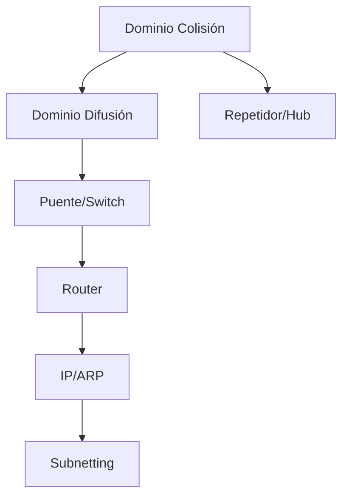

---
{"dg-publish":true,"permalink":"/redes/arc-tema-3/00-arc-tema-3-indice/","dg-note-properties":{"tipo":"indice","tema":"Protocolos y Dispositivos en Redes de Área Local","pdf":"mega/MEGA/Aprender/Redes/PDF/ARC_Tema_3.pdf"}}
---

# 00 ARC_Tema_3 - Índice

## Tema
Dispositivos de interconexión LAN (repetidor, hub, puente, switch, router, gateway), dominios de colisión/difusión, protocolos IP/ARP/subredes.

## Verdades base (nivel 0)
- [[Redes/ARC_Tema_3/Conceptos/Dominio de Colisión\|Dominio de Colisión]]: segmento físico donde tramas pueden colisionar
- [[Redes/ARC_Tema_3/Conceptos/Dominio de Difusión\|Dominio de Difusión]]: área alcanzable por tramas de difusión
- [[Redes/ARC_Tema_3/Conceptos/Repetidor y Hub\|Repetidor y Hub]]: nivel 1 (físico), expanden colisión y difusión
- [[Redes/ARC_Tema_3/Conceptos/Puente y Switch\|Puente y Switch]]: nivel 2 (MAC), dividen colisión, expanden difusión
- [[Redes/ARC_Tema_3/Conceptos/Router\|Router]]: nivel 3 (IP), conecta redes heterogéneas
- [[Redes/ARC_Tema_3/Conceptos/IP y ARP\|IP y ARP]]: direccionamiento lógico, resolución MAC, fragmentación

## Mapa de dependencias

## Ruta de estudio
1. Conceptos previos (dominios, rack) → 2. Repetidor/Hub → 3. Puente/Switch → 4. Router → 5. IP, direccionamiento, máscara → 6. ARP, fragmentación, encaminamiento → 7. Subnetting / Gateway

## Enlaces
- [[Redes/ARC_Tema_3/Fuente - ARC_Tema_3\|Fuente - ARC_Tema_3]]
- [[Redes/ARC_Tema_3/01 ARC_Tema_3 - Contraste\|01 ARC_Tema_3 - Contraste]]
- [[Redes/ARC_Tema_3/_ARC_Tema_3 - Progreso\|_ARC_Tema_3 - Progreso]]
- [[Redes/ARC_Tema_3/Conceptos/Dominio de Colisión\|Dominio de Colisión]]
- [[Redes/ARC_Tema_3/Conceptos/Dominio de Difusión\|Dominio de Difusión]]
- [[Redes/ARC_Tema_3/Conceptos/Fragmentación de Datagramas IP\|Fragmentación de Datagramas IP]]
- [[Redes/ARC_Tema_3/Conceptos/Gateway\|Gateway]]
- [[Redes/ARC_Tema_3/Conceptos/IP y ARP\|IP y ARP]]
- [[Redes/ARC_Tema_3/Conceptos/Puente y Switch\|Puente y Switch]]
- [[Redes/ARC_Tema_3/Conceptos/Repetidor y Hub\|Repetidor y Hub]]
- [[Redes/ARC_Tema_3/Conceptos/Router\|Router]]
- [[Redes/ARC_Tema_3/Conceptos/Subnetting y Supernetting\|Subnetting y Supernetting]]
