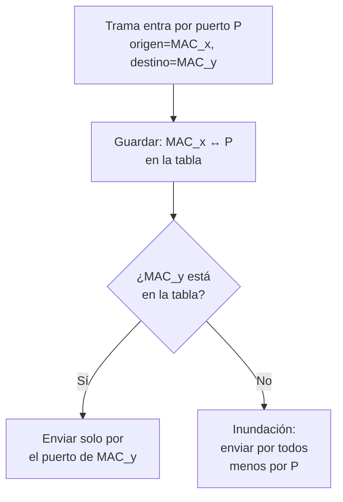

---
{"dg-publish":true,"permalink":"/redes/arc-tema-3/conceptos/puente-y-switch/","tags":["materia/redes","tema/protocolos"],"dg-note-properties":{"tipo":"concepto","aliases":["Conmutador","Switch LAN","Bridge","Puente","Switch"],"tags":["materia/redes","tema/protocolos"],"nivel":1,"fuentes":["[[Redes/ARC_Tema_3/Fuente - ARC_Tema_3]]"],"contraste":"verificado","estado":"nuevo"}}
---

# Puente y Switch

> [!abstract] En una frase
> Dispositivos de **nivel 2 (MAC)** que **aprenden** por qué puerto está cada dirección física y, con esa tabla, **reenvían las tramas solo por el puerto correcto**: dividen el dominio de colisión y dan **ancho de banda dedicado** por puerto, aunque siguen expandiendo el dominio de difusión.

## ¿Qué problema resuelve?
Un [[Redes/ARC_Tema_3/Conceptos/Repetidor y Hub\|hub]] mejora la **distancia** pero no el **rendimiento**: todas las estaciones comparten el mismo canal y, cuantas más haya, más colisiones. La pregunta natural es: *¿y si en vez de replicar la trama por todos los puertos, el dispositivo supiera por cuál enviarla?* La respuesta es el **puente** y, con muchos puertos, el **switch**. Al leer la dirección MAC destino y conocer **qué estación cuelga de cada puerto**, el dispositivo convierte un medio compartido en una colección de **enlaces dedicados**.

## Qué es

### Puente (Bridge)
Según el material (p. 11-12): *"Conectan LAN con idénticos protocolos de capa física y Capa de Acceso al Medio (MAC). Posee una tabla de direcciones físicas MAC/Puertos. Funcionamiento transparente: cuando recibe una trama almacena la MAC de origen y el puerto"*. Trabaja en el **Nivel 2 (MAC)** (p. 12).

Idea: *"**El Puente va aprendiendo** y completando la tabla MAC-PUERTO"* (p. 11). El puente clásico tiene **pocos puertos** (típicamente 2); el switch es su generalización moderna a muchos puertos con hardware rápido.

### Switch (Conmutador)
Según el material (p. 13): *"Conectan varios puertos con idénticos protocolos de capa física y Capa de Acceso al Medio (MAC). Posee una tabla de direcciones físicas MAC/Puertos. Debe existir un único camino para cada destino (bucles cerrados). Proporcionan un ancho de banda dedicado (10M, 100M, 1G o 10G)"*. También opera en el **Nivel 2 (MAC)** (p. 14).

### Aprendizaje (p. 14)
Los switches arrancan con **tablas vacías** y las construyen observando el tráfico:

Reglas:
1. Al **recibir** una trama por el puerto P con origen *MAC_x*, almacena `MAC_x ↔ P` en la tabla.
2. Al **enviar**: si conoce el puerto de destino, envía **solo por él**; si no lo conoce, **inunda** (envía por todos menos por el que recibió).

Con el tiempo la tabla se completa y la inundación es cada vez más rara.

### Tipos de switch (p. 15)
Según el **método de direccionamiento**:

| Tipo | Mecanismo | Pros | Contras |
|---|---|---|---|
| **Store-and-Forward** | Guarda la trama entera, **comprueba CRC** y reenvía (o descarta). | Tramas sin error en salida. | **Más retardo**, crece con el tamaño de trama. Redes corporativas con control de errores. |
| **Cut-Through** | Al recibir los **6 bytes de MAC destino**, ya reenvía. | Muy rápido. | **No detecta CRC** ni colisiones. Redes pequeñas o con alto volumen. |
| **Fragment Free** | Espera a los **primeros 64 bytes** antes de reenviar. | Evita retransmitir colisiones (que ocurren en los primeros bytes). | Compromiso entre S&F y Cut-Through. |
| **Adaptative Cut-Through** | Alterna entre S&F y Cut-Through, por administración o automáticamente según la **media de errores**. | Lo mejor de los dos mundos. | Más complejo. |

### Dominios de colisión y difusión (p. 16-17)
- **Colisión**: lo **divide** (p. 16). Dos estaciones en puertos distintos pueden transmitir **a la vez sin colisión**; si una trama es errónea (CRC), **se descarta**.
- **Difusión**: lo **expande** (p. 17). El switch/puente reenvía las tramas de difusión (`FF:FF:FF:FF:FF:FF`) por **todos sus puertos**.

## Cómo podrías haberlo descubierto
Si tienes un **hub** con 10 estaciones, cada bit se repite por los 10 puertos: la mitad del tráfico no interesa a cada estación y, encima, hay colisiones. La idea natural es: *"el dispositivo debería mirar la **dirección destino** y enviar solo por el puerto correcto"*. Pero ¿cómo sabe por qué puerto está cada MAC? La solución elegante no es **configurarlo a mano**, sino **aprender observando**: cada vez que llega una trama, me entero de que la MAC de origen **cuelga del puerto por el que entró**. Esa única regla es suficiente, siempre que al principio, mientras aún no sabes dónde está un destino, **inundes** por todos los puertos (como un hub). Esa es exactamente la receta descrita en p. 14.

## Depende de
- [[Redes/ARC_Tema_3/Conceptos/Repetidor y Hub\|Repetidor y Hub]]: contraste directo; el switch es el "hub con cerebro".
- [[Redes/ARC_Tema_2/Conceptos/Subcapa MAC\|Subcapa MAC]] (Tema 2): el switch mira **direcciones MAC** y entiende el formato de trama.
- [[Redes/ARC_Tema_2/Conceptos/Protocolo Subcapa MAC - Formato Trama\|Protocolo Subcapa MAC - Formato Trama]] (Tema 2): el switch necesita leer la cabecera MAC para su operación.
- [[Redes/ARC_Tema_3/Conceptos/Dominio de Colisión\|Dominio de Colisión]] y [[Redes/ARC_Tema_3/Conceptos/Dominio de Difusión\|Dominio de Difusión]]: el switch divide uno y expande el otro.

## Permite entender
- Por qué una LAN **moderna no tiene colisiones**: los switches han sustituido a los hubs.
- Por qué, aun así, los **ARP** y los **broadcast** siguen llegando a todas las estaciones: la difusión no se divide, solo se divide con un **router** o una **VLAN**.
- La necesidad de **evitar bucles**: *"debe existir un único camino para cada destino (bucles cerrados)"* (p. 13), de donde nace el protocolo *Spanning Tree*.
- La diferencia práctica entre S&F (fiable, lento) y Cut-Through (rápido, no detecta errores) al elegir equipamiento (p. 15).

## Ejemplo
> [!example]
> Switch S1 con 4 puertos (A, B, C, D). Al arrancar, tabla vacía. A manda una trama a B: S1 **inunda** por todos salvo A y aprende `MAC_A ↔ Eth0`. B responde a A: S1 ya conoce `MAC_A`, envía **solo** por Eth0, y además aprende `MAC_B ↔ Eth1`. A partir de ese momento el tráfico A↔B viaja punto a punto sin ser visto por C ni D: no hay colisiones **y** se gana privacidad (p. 14).

## Errores comunes
> [!warning]
> **Un switch no divide la difusión**. Las tramas de ARP, DHCP o cualquier `FF:FF:FF:FF:FF:FF` llegan a todos los puertos (p. 17). Para dividir difusión hace falta un **router** o **VLANs**.

> [!warning]
> **La inundación no es broadcast**: la inundación por desconocimiento del destino es un recurso transitorio del switch mientras aprende la MAC; el broadcast es un **destino explícito**. Son fenómenos distintos aunque el efecto temporal se parezca.

> [!warning]
> **Cut-Through no comprueba CRC**: puede propagar tramas corruptas. En redes con muchos errores físicos no es la mejor elección (p. 15).

> [!warning]
> **Un switch mal cableado puede crear un bucle** y provocar una tormenta de tramas en el nivel 2 (sin TTL que las mate). Por eso el material insiste en "**un único camino para cada destino**" (p. 13).

## Autoevaluación
> [!question]- ¿Cómo aprende un switch qué MAC está en cada puerto?
> **Observando el origen** de cada trama que entra: si llega por el puerto P una trama con `origen = MAC_x`, el switch anota `MAC_x ↔ P` en su tabla. Si al enviar no conoce aún el puerto del destino, **inunda** por todos los puertos salvo por el de entrada (p. 14).

> [!question]- Diferencia entre un switch Store-and-Forward y uno Cut-Through.
> **S&F** espera a tener la trama completa, **comprueba CRC** y reenvía (o descarta si está mal). Es más lento pero fiable. **Cut-Through** reenvía en cuanto lee los **6 bytes de MAC destino**: muy rápido, pero **no detecta errores**. *Fragment Free* es un intermedio que espera los primeros **64 bytes** para evitar retransmitir colisiones (p. 15).

> [!question]- ¿Qué pasa con el dominio de colisión y el de difusión al poner un switch entre dos redes?
> **Divide** el dominio de colisión (cada puerto es independiente) pero **expande** el dominio de difusión (reenvía las tramas de difusión por todos los puertos). Para dividir también la difusión hace falta un router (p. 16-17, 48).

## Contraste
> [!success] Verificado
> La operación por aprendizaje de MAC, los tipos de switch (S&F / Cut-Through / Fragment Free / Adaptative) y el comportamiento ante colisión/difusión se han contrastado con Wikipedia (*Network switch*, *Bridging (networking)*) y con la literatura habitual (Tanenbaum). Coincide con el material.

## Fuentes
- [[Redes/ARC_Tema_3/Fuente - ARC_Tema_3\|Fuente - ARC_Tema_3]], p. 11-17, 48

## Mis notas
