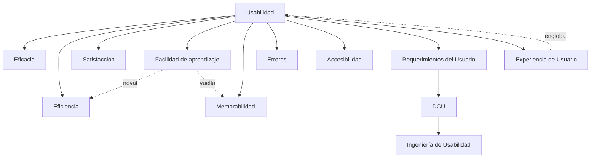

---
{"dg-publish":true,"permalink":"/usabilidad/tema-1-1-introd-ing-usab-26-27/00-tema-1-1-introd-ing-usab-26-27-indice/","dg-note-properties":{"tipo":"indice","pdf":"PDF/Tema 1.1-Introd_Ing_Usab_26-27.pdf","paginas":90}}
---

# 00 Tema 1.1-Introd_Ing_Usab_26-27 - Índice

[[index\|← Inicio]]

## Idea central
Fijar el **concepto de usabilidad** como una propiedad **medible** del sistema interactivo (y no como una impresión estética): la medida en la que un usuario alcanza objetivos con [[Usabilidad /Tema 1.1-Introd_Ing_Usab_26-27/Conceptos/Eficacia\|Eficacia]], [[Usabilidad /Tema 1.1-Introd_Ing_Usab_26-27/Conceptos/Eficiencia\|Eficiencia]] y [[Usabilidad /Tema 1.1-Introd_Ing_Usab_26-27/Conceptos/Satisfacción\|Satisfacción]] en un contexto dado (ISO 9241-210:2019). A partir de ahí, derivar los 6 atributos consolidados (ISO + Jakob Nielsen), situar la [[Usabilidad /Tema 1.1-Introd_Ing_Usab_26-27/Conceptos/Usabilidad\|Usabilidad]] frente a la [[Usabilidad /Tema 1.1-Introd_Ing_Usab_26-27/Conceptos/Accesibilidad\|Accesibilidad]] y a la [[Usabilidad /Tema 1.1-Introd_Ing_Usab_26-27/Conceptos/Experiencia de Usuario\|Experiencia de Usuario]] (UX), y presentar la [[Usabilidad /Tema 1.1-Introd_Ing_Usab_26-27/Conceptos/Ingeniería de Usabilidad\|Ingeniería de Usabilidad]] y el [[Usabilidad /Tema 1.1-Introd_Ing_Usab_26-27/Conceptos/DCU\|DCU]] como el método y el paradigma para producirla.

## Verdades base (nivel 0)
- **[[Usabilidad /Tema 1.1-Introd_Ing_Usab_26-27/Conceptos/Usabilidad\|Usabilidad]]**: *medida* en la que un sistema puede usarse por determinados usuarios para conseguir objetivos específicos con eficacia, eficiencia y satisfacción en un contexto de uso especificado (ISO 9241-210:2019). No es una propiedad absoluta: depende de usuarios, objetivos y contexto.

## Mapa de dependencias (mermaid)

## Ruta de estudio (topológico)
1. [[Usabilidad /Tema 1.1-Introd_Ing_Usab_26-27/Conceptos/Usabilidad\|Usabilidad]] (raíz) — definición ISO 9241-210:2019.
2. Los **3 atributos ISO**: [[Usabilidad /Tema 1.1-Introd_Ing_Usab_26-27/Conceptos/Eficacia\|Eficacia]], [[Usabilidad /Tema 1.1-Introd_Ing_Usab_26-27/Conceptos/Eficiencia\|Eficiencia]], [[Usabilidad /Tema 1.1-Introd_Ing_Usab_26-27/Conceptos/Satisfacción\|Satisfacción]].
3. Los **5 atributos de Jakob Nielsen** (los dos nuevos): [[Usabilidad /Tema 1.1-Introd_Ing_Usab_26-27/Conceptos/Facilidad de aprendizaje\|Facilidad de aprendizaje]], [[Usabilidad /Tema 1.1-Introd_Ing_Usab_26-27/Conceptos/Memorabilidad\|Memorabilidad]], [[Usabilidad /Tema 1.1-Introd_Ing_Usab_26-27/Conceptos/Errores\|Errores]].
4. [[Usabilidad /Tema 1.1-Introd_Ing_Usab_26-27/Conceptos/Accesibilidad\|Accesibilidad]] — como propiedad complementaria y como atributo ISO 25010.
5. [[Usabilidad /Tema 1.1-Introd_Ing_Usab_26-27/Conceptos/Requerimientos del Usuario\|Requerimientos del Usuario]] — entrada del proceso de diseño.
6. [[Usabilidad /Tema 1.1-Introd_Ing_Usab_26-27/Conceptos/DCU\|DCU]] (Diseño Centrado en el Usuario) — paradigma de IPO.
7. [[Usabilidad /Tema 1.1-Introd_Ing_Usab_26-27/Conceptos/Ingeniería de Usabilidad\|Ingeniería de Usabilidad]] — método sistemático y disciplinado.
8. [[Usabilidad /Tema 1.1-Introd_Ing_Usab_26-27/Conceptos/Experiencia de Usuario\|Experiencia de Usuario]] (UX) — concepto más amplio que engloba la usabilidad.

## Índice por tema

**Fuente y auxiliares**
- [[Usabilidad /Tema 1.1-Introd_Ing_Usab_26-27/Fuente - Tema 1.1-Introd_Ing_Usab_26-27\|Fuente - Tema 1.1-Introd_Ing_Usab_26-27]] — resumen del PDF, estructura y registro de lectura.
- [[Usabilidad /Tema 1.1-Introd_Ing_Usab_26-27/01 Tema 1.1-Introd_Ing_Usab_26-27 - Contraste\|01 Tema 1.1-Introd_Ing_Usab_26-27 - Contraste]] — informe de verificación con fuentes externas.
- [[Usabilidad /Tema 1.1-Introd_Ing_Usab_26-27/_Tema 1.1-Introd_Ing_Usab_26-27 - Progreso\|_Tema 1.1-Introd_Ing_Usab_26-27 - Progreso]] — tabla de progreso y repaso espaciado.

**Conceptos (orden de la ruta de estudio)**
1. [[Usabilidad /Tema 1.1-Introd_Ing_Usab_26-27/Conceptos/Usabilidad\|Usabilidad]]
2. [[Usabilidad /Tema 1.1-Introd_Ing_Usab_26-27/Conceptos/Eficacia\|Eficacia]]
3. [[Usabilidad /Tema 1.1-Introd_Ing_Usab_26-27/Conceptos/Eficiencia\|Eficiencia]]
4. [[Usabilidad /Tema 1.1-Introd_Ing_Usab_26-27/Conceptos/Satisfacción\|Satisfacción]]
5. [[Usabilidad /Tema 1.1-Introd_Ing_Usab_26-27/Conceptos/Facilidad de aprendizaje\|Facilidad de aprendizaje]]
6. [[Usabilidad /Tema 1.1-Introd_Ing_Usab_26-27/Conceptos/Memorabilidad\|Memorabilidad]]
7. [[Usabilidad /Tema 1.1-Introd_Ing_Usab_26-27/Conceptos/Errores\|Errores]]
8. [[Usabilidad /Tema 1.1-Introd_Ing_Usab_26-27/Conceptos/Accesibilidad\|Accesibilidad]]
9. [[Usabilidad /Tema 1.1-Introd_Ing_Usab_26-27/Conceptos/Requerimientos del Usuario\|Requerimientos del Usuario]]
10. [[Usabilidad /Tema 1.1-Introd_Ing_Usab_26-27/Conceptos/DCU\|DCU]]
11. [[Usabilidad /Tema 1.1-Introd_Ing_Usab_26-27/Conceptos/Ingeniería de Usabilidad\|Ingeniería de Usabilidad]]
12. [[Usabilidad /Tema 1.1-Introd_Ing_Usab_26-27/Conceptos/Experiencia de Usuario\|Experiencia de Usuario]]
