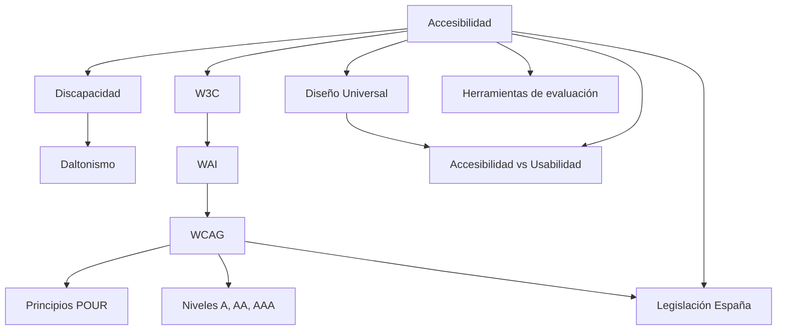

---
{"dg-publish":true,"permalink":"/usabilidad/tema-1-2-accesibilidad-26-27/00-tema-1-2-accesibilidad-26-27-indice/","dg-note-properties":{"tipo":"indice","pdf":"PDF/Tema 1.2-Accesibilidad-26-27.pdf","paginas":106}}
---

# 00 Tema 1.2-Accesibilidad-26-27 - Índice

[[index\|← Inicio]]

## Idea central
Desarrollar el concepto de **[[Usabilidad /Tema 1.1-Introd_Ing_Usab_26-27/Conceptos/Accesibilidad\|Accesibilidad]]** que el Tema 1.1 solo introdujo: su definición (ISO 9241-171:2025 + sentido legal), el ideal de **[[Usabilidad /Tema 1.2-Accesibilidad-26-27/Conceptos/Diseño Universal\|Diseño Universal]]** y sus 7 principios, el mapa de **[[Usabilidad /Tema 1.2-Accesibilidad-26-27/Conceptos/Discapacidad\|discapacidades]]** y las técnicas de adaptación para cada una, y el ecosistema web que convierte la accesibilidad en algo medible y exigible: **[[Usabilidad /Tema 1.2-Accesibilidad-26-27/Conceptos/W3C\|W3C]] → [[Usabilidad /Tema 1.2-Accesibilidad-26-27/Conceptos/WAI\|WAI]] → [[Usabilidad /Tema 1.2-Accesibilidad-26-27/Conceptos/WCAG\|WCAG]]** con sus **[[Usabilidad /Tema 1.2-Accesibilidad-26-27/Conceptos/Principios POUR\|Principios POUR]]** y sus tres **[[Usabilidad /Tema 1.2-Accesibilidad-26-27/Conceptos/Niveles de conformidad WCAG\|niveles de conformidad]]**. Al final, el tema cierra situando la [[Usabilidad /Tema 1.2-Accesibilidad-26-27/Conceptos/Accesibilidad vs Usabilidad\|Accesibilidad vs Usabilidad]] en sus cuatro casos y presenta las [[Usabilidad /Tema 1.2-Accesibilidad-26-27/Conceptos/Herramientas de evaluación de accesibilidad\|Herramientas de evaluación de accesibilidad]] y la [[Usabilidad /Tema 1.2-Accesibilidad-26-27/Conceptos/Legislación de accesibilidad en España\|Legislación de accesibilidad en España]].

## Verdades base (nivel 0)
- **[[Usabilidad /Tema 1.1-Introd_Ing_Usab_26-27/Conceptos/Accesibilidad\|Accesibilidad]]** (compartida con Tema 1.1): grado en que productos, sistemas, servicios y entornos pueden ser utilizados por personas con la mayor variedad posible de necesidades, características y capacidades (ISO 9241-171:2025, p. 4). Operativamente: *acceso de las personas con discapacidad en las mismas condiciones que el resto*.

## Mapa de dependencias (mermaid)

## Ruta de estudio (topológico)
1. **[[Usabilidad /Tema 1.1-Introd_Ing_Usab_26-27/Conceptos/Accesibilidad\|Accesibilidad]]** (raíz, compartida con Tema 1.1) — definición ISO 9241-171:2025 y legal.
2. **[[Usabilidad /Tema 1.2-Accesibilidad-26-27/Conceptos/Discapacidad\|Discapacidad]]** — definición y 4 familias (visual, auditiva, motriz, cognitiva).
3. **[[Usabilidad /Tema 1.2-Accesibilidad-26-27/Conceptos/Daltonismo\|Daltonismo]]** — ejemplo concreto para derivar reglas de diseño por color.
4. **[[Usabilidad /Tema 1.2-Accesibilidad-26-27/Conceptos/Diseño Universal\|Diseño Universal]]** — 7 principios de NC State; objetivo proactivo.
5. **[[Usabilidad /Tema 1.2-Accesibilidad-26-27/Conceptos/W3C\|W3C]]** y **[[Usabilidad /Tema 1.2-Accesibilidad-26-27/Conceptos/WAI\|WAI]]** — quién define los estándares web de accesibilidad.
6. **[[Usabilidad /Tema 1.2-Accesibilidad-26-27/Conceptos/WCAG\|WCAG]]** — evolución 1.0 → 2.0 → 2.1 → 2.2.
7. **[[Usabilidad /Tema 1.2-Accesibilidad-26-27/Conceptos/Principios POUR\|Principios POUR]]** — la columna vertebral de WCAG 2.x.
8. **[[Usabilidad /Tema 1.2-Accesibilidad-26-27/Conceptos/Niveles de conformidad WCAG\|Niveles de conformidad WCAG]]** — A, AA, AAA.
9. **[[Usabilidad /Tema 1.2-Accesibilidad-26-27/Conceptos/Legislación de accesibilidad en España\|Legislación de accesibilidad en España]]** — LSSICE 34/2002, RD 1494/2007, RD 1112/2018 (EN 301 549 → WCAG 2.1 AA).
10. **[[Usabilidad /Tema 1.2-Accesibilidad-26-27/Conceptos/Herramientas de evaluación de accesibilidad\|Herramientas de evaluación de accesibilidad]]** — TAW, WAVE, Siteimprove, Color Contrast Analyzer, validator.w3.org.
11. **[[Usabilidad /Tema 1.2-Accesibilidad-26-27/Conceptos/Accesibilidad vs Usabilidad\|Accesibilidad vs Usabilidad]]** — los 4 casos y el ideal del Diseño Universal.

## Índice por tema

**Fuente y auxiliares**
- [[Usabilidad /Tema 1.2-Accesibilidad-26-27/Fuente - Tema 1.2-Accesibilidad-26-27\|Fuente - Tema 1.2-Accesibilidad-26-27]] — resumen del PDF, estructura y registro de lectura.
- [[Usabilidad /Tema 1.2-Accesibilidad-26-27/01 Tema 1.2-Accesibilidad-26-27 - Contraste\|01 Tema 1.2-Accesibilidad-26-27 - Contraste]] — informe de verificación con fuentes externas.
- [[Usabilidad /Tema 1.2-Accesibilidad-26-27/_Tema 1.2-Accesibilidad-26-27 - Progreso\|_Tema 1.2-Accesibilidad-26-27 - Progreso]] — tabla de progreso y repaso espaciado.

**Conceptos (orden de la ruta de estudio)**
1. [[Usabilidad /Tema 1.1-Introd_Ing_Usab_26-27/Conceptos/Accesibilidad\|Accesibilidad]] (ampliada; compartida con Tema 1.1)
2. [[Usabilidad /Tema 1.2-Accesibilidad-26-27/Conceptos/Discapacidad\|Discapacidad]]
3. [[Usabilidad /Tema 1.2-Accesibilidad-26-27/Conceptos/Daltonismo\|Daltonismo]]
4. [[Usabilidad /Tema 1.2-Accesibilidad-26-27/Conceptos/Diseño Universal\|Diseño Universal]]
5. [[Usabilidad /Tema 1.2-Accesibilidad-26-27/Conceptos/W3C\|W3C]]
6. [[Usabilidad /Tema 1.2-Accesibilidad-26-27/Conceptos/WAI\|WAI]]
7. [[Usabilidad /Tema 1.2-Accesibilidad-26-27/Conceptos/WCAG\|WCAG]]
8. [[Usabilidad /Tema 1.2-Accesibilidad-26-27/Conceptos/Principios POUR\|Principios POUR]]
9. [[Usabilidad /Tema 1.2-Accesibilidad-26-27/Conceptos/Niveles de conformidad WCAG\|Niveles de conformidad WCAG]]
10. [[Usabilidad /Tema 1.2-Accesibilidad-26-27/Conceptos/Legislación de accesibilidad en España\|Legislación de accesibilidad en España]]
11. [[Usabilidad /Tema 1.2-Accesibilidad-26-27/Conceptos/Herramientas de evaluación de accesibilidad\|Herramientas de evaluación de accesibilidad]]
12. [[Usabilidad /Tema 1.2-Accesibilidad-26-27/Conceptos/Accesibilidad vs Usabilidad\|Accesibilidad vs Usabilidad]]
