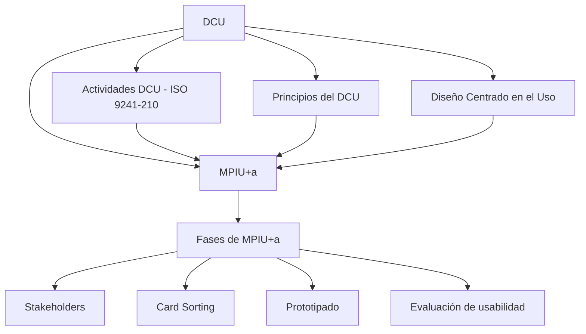

---
{"dg-publish":true,"permalink":"/usabilidad/tema-1-3-dcu-mpi-ua-26-27/00-tema-1-3-dcu-mpi-ua-26-27-indice/","dg-note-properties":{"tipo":"indice","pdf":"PDF/Tema 1.3-DCU-MPIUa-26-27.pdf","paginas":83}}
---

# 00 Tema 1.3-DCU-MPIUa-26-27 - Índice

[[index\|← Inicio]]

## Idea central
Pasar del **qué** (Usabilidad, Accesibilidad) al **cómo**: formalizar el **[[Usabilidad /Tema 1.1-Introd_Ing_Usab_26-27/Conceptos/DCU\|DCU]]** mediante la norma **ISO 9241-210:2019** (4 actividades iterativas) y presentar **[[Usabilidad /Tema 1.3-DCU-MPIUa-26-27/Conceptos/MPIU+a\|MPIU+a]]**, el modelo de proceso que integra Ingeniería del Software, Ingeniería de la Usabilidad y Accesibilidad en 6 fases (Análisis → Diseño → Prototipado → Evaluación → Implementación → Lanzamiento), con sus técnicas asociadas: [[Usabilidad /Tema 1.3-DCU-MPIUa-26-27/Conceptos/Stakeholders\|Stakeholders]], [[Usabilidad /Tema 1.3-DCU-MPIUa-26-27/Conceptos/Card Sorting\|Card Sorting]], [[Usabilidad /Tema 1.3-DCU-MPIUa-26-27/Conceptos/Prototipado\|Prototipado]] y [[Usabilidad /Tema 1.3-DCU-MPIUa-26-27/Conceptos/Evaluación de usabilidad\|Evaluación de usabilidad]].

## Verdades base (nivel 0)
- **[[Usabilidad /Tema 1.1-Introd_Ing_Usab_26-27/Conceptos/DCU\|DCU]]** (compartida con Tema 1.1): paradigma de la Interacción Persona-Ordenador que coloca al usuario, sus necesidades, objetivos y capacidades, en el centro de las decisiones de diseño. Operacionalizado por la ISO 9241-210:2019.

## Mapa de dependencias (mermaid)

## Ruta de estudio (topológico)
1. **[[Usabilidad /Tema 1.1-Introd_Ing_Usab_26-27/Conceptos/DCU\|DCU]]** (raíz, ya conocida del Tema 1.1).
2. **[[Usabilidad /Tema 1.3-DCU-MPIUa-26-27/Conceptos/Actividades DCU (ISO 9241-210)\|Actividades DCU (ISO 9241-210)]]** — las 4 actividades iterativas.
3. **[[Usabilidad /Tema 1.3-DCU-MPIUa-26-27/Conceptos/Principios del DCU\|Principios del DCU]]** — balance, inclusión activa, iteración, equipos multidisciplinares.
4. **[[Usabilidad /Tema 1.3-DCU-MPIUa-26-27/Conceptos/Diseño Centrado en el Uso\|Diseño Centrado en el Uso]]** — la distinción conceptual.
5. **[[Usabilidad /Tema 1.3-DCU-MPIUa-26-27/Conceptos/Stakeholders\|Stakeholders]]** — los implicados a identificar.
6. **[[Usabilidad /Tema 1.3-DCU-MPIUa-26-27/Conceptos/MPIU+a\|MPIU+a]]** — el modelo integrado.
7. **[[Usabilidad /Tema 1.3-DCU-MPIUa-26-27/Conceptos/Fases de MPIU+a\|Fases de MPIU+a]]** — Análisis → Diseño → Prototipado → Evaluación → Implementación → Lanzamiento.
8. **[[Usabilidad /Tema 1.3-DCU-MPIUa-26-27/Conceptos/Prototipado\|Prototipado]]** — fase 3.
9. **[[Usabilidad /Tema 1.3-DCU-MPIUa-26-27/Conceptos/Card Sorting\|Card Sorting]]** — técnica compartida de Diseño y Evaluación.
10. **[[Usabilidad /Tema 1.3-DCU-MPIUa-26-27/Conceptos/Evaluación de usabilidad\|Evaluación de usabilidad]]** — fase 4: Inspección, Indagación, Test.

## Índice por tema

**Fuente y auxiliares**
- [[Usabilidad /Tema 1.3-DCU-MPIUa-26-27/Fuente - Tema 1.3-DCU-MPIUa-26-27\|Fuente - Tema 1.3-DCU-MPIUa-26-27]] — resumen del PDF, estructura y registro de lectura.
- [[Usabilidad /Tema 1.3-DCU-MPIUa-26-27/01 Tema 1.3-DCU-MPIUa-26-27 - Contraste\|01 Tema 1.3-DCU-MPIUa-26-27 - Contraste]] — informe de verificación con fuentes externas.
- [[Usabilidad /Tema 1.3-DCU-MPIUa-26-27/_Tema 1.3-DCU-MPIUa-26-27 - Progreso\|_Tema 1.3-DCU-MPIUa-26-27 - Progreso]] — tabla de progreso y repaso espaciado.

**Conceptos (orden de la ruta de estudio)**
1. [[Usabilidad /Tema 1.1-Introd_Ing_Usab_26-27/Conceptos/DCU\|DCU]] (ampliada; compartida con Tema 1.1)
2. [[Usabilidad /Tema 1.3-DCU-MPIUa-26-27/Conceptos/Actividades DCU (ISO 9241-210)\|Actividades DCU (ISO 9241-210)]]
3. [[Usabilidad /Tema 1.3-DCU-MPIUa-26-27/Conceptos/Principios del DCU\|Principios del DCU]]
4. [[Usabilidad /Tema 1.3-DCU-MPIUa-26-27/Conceptos/Diseño Centrado en el Uso\|Diseño Centrado en el Uso]]
5. [[Usabilidad /Tema 1.3-DCU-MPIUa-26-27/Conceptos/Stakeholders\|Stakeholders]]
6. [[Usabilidad /Tema 1.3-DCU-MPIUa-26-27/Conceptos/MPIU+a\|MPIU+a]]
7. [[Usabilidad /Tema 1.3-DCU-MPIUa-26-27/Conceptos/Fases de MPIU+a\|Fases de MPIU+a]]
8. [[Usabilidad /Tema 1.3-DCU-MPIUa-26-27/Conceptos/Prototipado\|Prototipado]]
9. [[Usabilidad /Tema 1.3-DCU-MPIUa-26-27/Conceptos/Card Sorting\|Card Sorting]]
10. [[Usabilidad /Tema 1.3-DCU-MPIUa-26-27/Conceptos/Evaluación de usabilidad\|Evaluación de usabilidad]]
